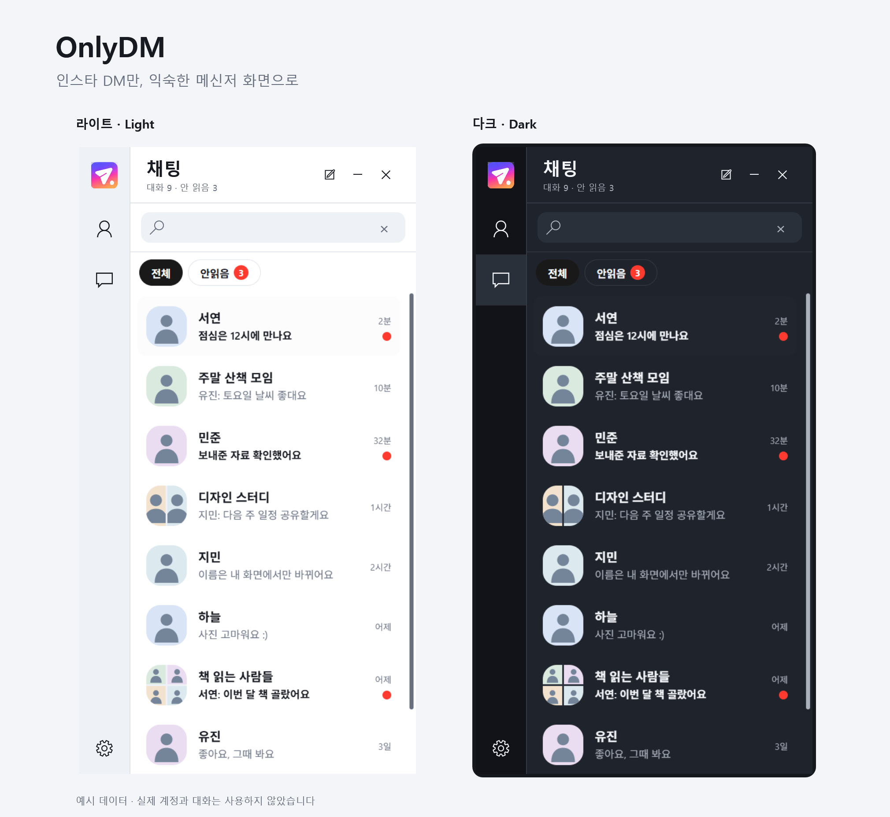
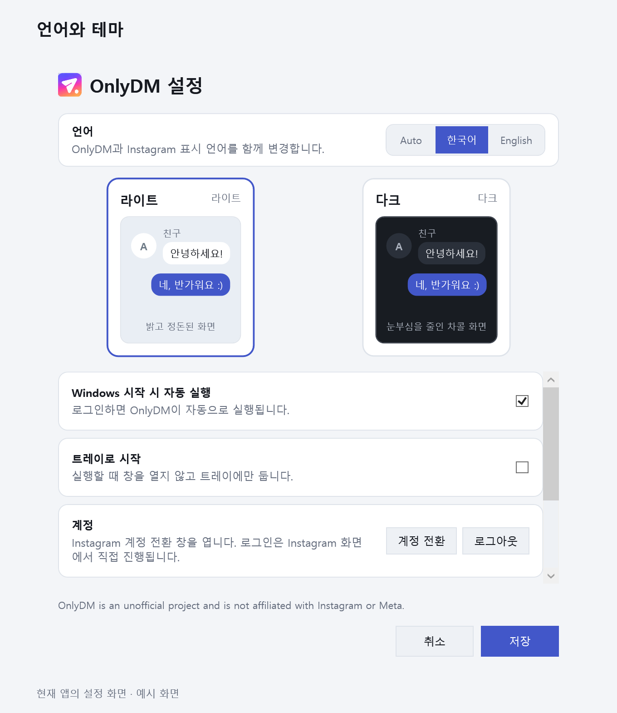

# OnlyDM

<p align="center">
  <a href="README.md">한국어</a> · <strong>English</strong>
</p>

**A desktop messenger that shows only your Instagram DMs.**

Leaving a regular messenger window open at work feels normal. Leaving Instagram open does not. There is always a feed, Reels, Stories, and far more than you need just to answer a message. Keeping your phone in your hand all day is not a great alternative either.

So I kept trimming until **only the DMs remained**. No feed, no Reels, and no Explore page—just a conversation list and chat windows that look and behave like a familiar desktop messenger.

If you have had the same problem, feel free to use it.



<sub>The Windows app in light and dark themes, shown with fictional names, messages, and profile images. No real accounts or conversations are included.</sub>

## How it works

Sign-in and messaging happen entirely on **Instagram Web**. OnlyDM opens the same pages you would use in a browser, using Microsoft Edge WebView2 on Windows and Chromium in the Ubuntu preview.

OnlyDM then draws its own messenger interface over that page. It reads the conversation list Instagram has already rendered and presents it in a cleaner desktop layout. It does not use a private Instagram API, bypass authentication, or send your data through a separate server. There is no OnlyDM server at all.

## What it feels like

The Windows app is designed to work like a familiar desktop messenger.

**Conversations**

- Recent conversations move to the top, and unread conversations receive a red badge
- Search works with names, Instagram handles, and names you assign locally
- Double-click or press <kbd>Enter</kbd> to open a chat, use <kbd>↑</kbd> and <kbd>↓</kbd> to move, and press <kbd>Esc</kbd> to close
- Drafts remain when you close and reopen a chat window. They are not preserved after exiting the app or when an older cached window is released from memory
- OnlyDM remembers rooms you have already opened so they open much faster next time
- Clicking a web link in a chat opens the default browser and keeps the conversation open

**People**

- The Friends list comes from the accounts you follow. It is cached after the first load and can be refreshed when needed
- Open a profile to start a 1:1 chat, voice call, or video call
- To start a new conversation, just select people. One person creates a direct chat; multiple people create a group chat; an existing room opens instead of being duplicated

**Local names**

- Hover over a name in a chat title or profile card and edit it directly
- Names are attached to Instagram handles, so a change made in a chat also appears in Friends, and vice versa
- Group conversations can have their own local room name
- **These changes stay on your computer.** They do not change anything on Instagram or on anyone else's screen
- Clear a local name to restore the original one

**More**

- Light and dark themes are included. Click the **gear icon (Settings)** in the lower-left corner, choose a theme, and save to apply it to open windows
- Korean and English UI are supported. Under **Appearance and language** in Settings, choose `Auto`, `한국어`, or `English` and save. `Auto` uses Korean when the Windows display language is Korean, and English otherwise. Instagram's display language is updated too
- Settings also let you sign out or choose whether to start with Windows or start in the tray
- Closing the main window sends OnlyDM to the system tray. Right-click its icon to see whether notifications and Work mode are on, or to change the theme and startup settings
- If the embedded page stops responding, OnlyDM reloads it and can restart itself after a larger browser failure



<sub>On Windows, click the gear icon (Settings) in the lower-left corner to change the language and theme.</sub>

## Account switching and DM notifications

On Windows, go to **Settings → Switch account**. On Ubuntu, use **Switch accounts** above the conversation list. **Add account** opens Instagram's official sign-in page in a separate browser profile. Sign in to each new profile yourself the first time. After that, you can switch from the menu as long as the session stays signed in. For linked profiles, open Instagram's own profile picker with **Choose Instagram profile…** on Windows or **Instagram profiles…** on Ubuntu. Being signed in on your phone does not sign you in here.

While OnlyDM is running, it can show desktop notifications for new DMs in other accounts whose browser sessions are signed in. The notification shows which account received the DM. Click it to switch to that account's inbox. On Windows, a notification for the current account may open the chat. OnlyDM checks each account's inbox in the background without opening chat tabs. Ubuntu needs a running desktop notification service.

On Windows and Ubuntu, turn on **Work mode** in Settings to hide names and message text from new DM alerts across all accounts. The title becomes “System” and the body shows a generic notice. The sending app is still OnlyDM. On Windows, the tray menu also has a Work mode toggle, and you can separately choose whether to show message previews. The Ubuntu preview always omits the original message body, even with Work mode off.

If a temporary error prevents a background inbox from loading, OnlyDM keeps retrying without an attempt limit while the app is running. Windows usually waits 15–30 seconds between attempts. Ubuntu waits 5 seconds, then 30 seconds, 60 seconds, and 2 minutes, and continues at 2-minute intervals. OnlyDM stops checking an account if Instagram requires authentication again. Quitting the app stops all checks.

## Your data stays local

**Automatic sign-in is stored only on this computer.** WebView2 and Chromium keep the Instagram session just like a browser. OnlyDM does not separately extract or store your password, cookies, or tokens. Instagram Web handles sign-in and message traffic, and there is no OnlyDM server.

On Windows, local names, conversation addresses, and the cached Friends list are stored only on your PC. Windows DPAPI encrypts that metadata so it can only be opened by your Windows account.

On Windows, this data is stored under `%LOCALAPPDATA%\OnlyDM`.

| Path | Contents |
| --- | --- |
| `WebView2\` | First account's Instagram sign-in session, managed by WebView2 |
| `Accounts\<id>\` | Sign-in sessions and local data for added accounts |
| `settings.json` | Theme, language, notifications, Windows startup, and start-in-tray settings |
| `threads.json` · `friends.json` · `aliases.json` | Conversation addresses, Friends cache, and local names protected with DPAPI |
| `error.log` | Error records for troubleshooting |

Exit OnlyDM before deleting that folder to remove the sign-in session and local data. Run `odm uninstall` to remove the app as well. To also remove the npm CLI, run `npm uninstall -g @thisnorm/onlydm`.

See [PRIVACY.md](PRIVACY.md) for more details.

## Install

These installation instructions are for [GitHub release v1.1.3](https://github.com/thisNorm/OnlyDM/releases/tag/v1.1.3).

### Install on Windows with PowerShell

```powershell
$releaseTag = 'v1.1.3'
$installer = Join-Path $env:TEMP 'OnlyDM-install.ps1'
Invoke-WebRequest -Uri "https://github.com/thisNorm/OnlyDM/releases/download/$releaseTag/install.ps1" -OutFile $installer
& powershell.exe -NoProfile -ExecutionPolicy Bypass -File $installer -ReleaseTag $releaseTag
Remove-Item -LiteralPath $installer -Force
```

The installer selects x64 or ARM64 automatically, verifies the downloaded SHA-256 checksum, and installs OnlyDM under `%LOCALAPPDATA%\Programs\OnlyDM`. Administrator privileges are not required. Exit OnlyDM through the tray menu or `odm stop` before installing or updating it.

**Requirements:** Windows 10 or 11 on x64 or ARM64, and the Edge WebView2 Runtime. If WebView2 is missing, OnlyDM asks for permission before downloading and running Microsoft's official installer. The distributed build includes .NET, so a separate .NET installation is not required.

### Optional npm CLI for Windows

If you have Node.js 18 or newer, you can also use the npm CLI:

```powershell
npm install -g @thisnorm/onlydm
odm start
```

`odm start` launches the existing installation if it finds one. Otherwise, it installs the app release that matches the npm CLI version.

### Run and manage on Windows

| Command | Description |
| --- | --- |
| `odm start` · `odm stop` · `odm restart` | Start, stop, or restart OnlyDM |
| `odm status` | Show installation, process, WebView2, and startup status |
| `odm on` · `odm off` | Enable or disable startup with Windows |
| `odm update` | Update the app; behavior depends on the installation method below |
| `odm uninstall` | Remove the app and its local data |

On first launch or when the session expires, **Instagram's official sign-in page** appears first. Sign in there to open the OnlyDM conversation list. After sign-in, the feed, Reels, and Explore pages are not shown.

### Ubuntu 24.04 x64 preview

For the `OnlyDM-linux-x64.deb` release asset, see the [Ubuntu installation guide](linux/README.md). The preview covers the inbox, conversation search, reading and sending messages in existing chats, account switching, DM notifications, and Work mode. It does not include Friends, new conversations, voice or video calls, or a tray icon.

## Update on Windows

To update to v1.1.3, choose **Exit** in the OnlyDM tray menu and rerun the PowerShell installation commands above. The installer replaces app files while retaining your existing sign-in session and settings.

To update to the latest GitHub release, run the bundled CLI by its full path:

```powershell
& "$env:LOCALAPPDATA\Programs\OnlyDM\cli\odm.cmd" update
```

A globally installed npm `odm update` installs the GitHub release matching the npm CLI version. For example, npm CLI 0.2.9 installs app v0.2.9, which can downgrade an existing installation. `odm --version` reports the npm CLI version.

## Troubleshooting

**The sign-in page never appears and "Loading conversations" stays on screen** — The issue where a new session hid the sign-in page was fixed in v0.2.9. Update the app first. If it persists, [open an issue](https://github.com/thisNorm/OnlyDM/issues) with your version and a screenshot of the error, with conversation contents and other people's information hidden.

**Instagram requests additional verification** — If OnlyDM shows an official Instagram verification prompt, follow the instructions in the app to complete it.

**The conversation list is empty on first launch** — Instagram renders only a small part of a long conversation list at a time. OnlyDM makes one pass through the list to collect it, which can take a moment if you have many conversations.

## Build the Windows app from source

Development requires the .NET 8 SDK.

```powershell
# Run from source
dotnet run --project .\src\OnlyDM\OnlyDM.csproj

# Policy tests, Release build, distribution checks, and UI contract checks
powershell -ExecutionPolicy Bypass -File .\scripts\verify.ps1

# Create self-contained release archives and SHA-256 files under artifacts
powershell -ExecutionPolicy Bypass -File .\scripts\package.ps1
powershell -ExecutionPolicy Bypass -File .\scripts\package.ps1 -RuntimeIdentifier win-arm64
```

Pushing a `v*` tag runs the [release workflow](.github/workflows/release.yml), which verifies the project and publishes self-contained x64 and ARM64 builds with checksums to GitHub Releases.

<details>
<summary>Manual verification checklist</summary>

1. A fresh session shows the sign-in page, then only the conversation list after sign-in
2. The Instagram session remains available after restarting OnlyDM
3. Search filters the list and clearing it restores the full list
4. Two chat windows can be opened, and drafts remain after closing and reopening them while the app is running
5. A local name changed in a chat also changes in Friends and the conversation list
6. Clicking a DM notification for another account switches to that account's inbox
7. Theme and language choices remain after restarting
8. Closing the main window sends it to the tray, and the tray menu opens it again
9. `odm status`, `odm on`, `odm off`, and `odm restart` report and update the expected state
10. Reinstallation works, and uninstalling removes `%LOCALAPPDATA%\OnlyDM`

</details>

## License

OnlyDM is available under the [MIT License](LICENSE). You may use, modify, and redistribute it.

OnlyDM is an independent, unofficial project and is not affiliated with Instagram or Meta.
