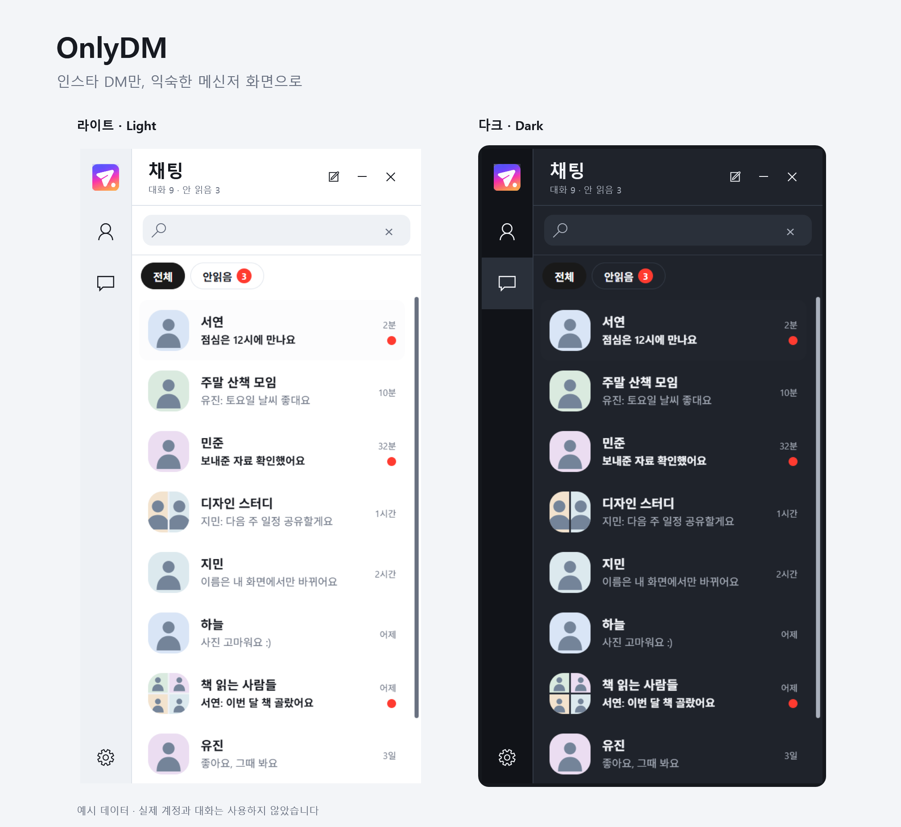

# OnlyDM

<p align="center"><strong>한국어</strong> · <a href="README.en.md">English</a></p>

**인스타 DM만 띄워두는 데스크톱 메신저.**

회사에서 카카오톡 창은 그냥 띄워두는데, 인스타그램은 그러기가 좀 그렇더라고요. 그렇다고 답장하겠다고 폰을 계속 들고 있을 수도 없고요.

그래서 피드·릴스·탐색은 빼고 DM만 남겼습니다. 익숙한 메신저 창처럼 편하게 쓸 수 있도록 만들었습니다. 같은 고민이 있으셨다면 편하게 가져다 쓰세요.

## 설치

[Node.js](https://nodejs.org/)를 설치한 뒤 **Windows의 명령 프롬프트(CMD), Ubuntu·macOS의 터미널에서 같은 명령**을 쓰면 됩니다. 설치 후에는 새 PowerShell에서도 `odm` 명령을 사용할 수 있습니다.

```sh
npm install -g @thisnorm/onlydm
odm install
odm start
```

운영체제와 CPU에 맞는 설치 파일을 자동으로 골라 검증합니다. Ubuntu·macOS에서는 운영체제의 관리자 권한 확인이 나올 수 있습니다.

`npm` 명령이 없거나 명령어로 설치하기 어렵다면 아래 [파일로 설치하기](#파일로-설치하기)를 이용하세요. 프로젝트를 내려받거나 설치 경로를 직접 설정할 필요는 없습니다.

지원 환경은 **Windows 10/11(x64·ARM64), Ubuntu 24.04 데스크톱(x64), macOS(Apple Silicon·Intel)**입니다.

## 업데이트

새 터미널에서 어디서든 실행하세요.

```sh
odm update
```

앱에서도 **새 버전이 있을 때만 왼쪽 바 맨 아래에 업데이트 버튼**이 나타납니다. 누르면 설치 후 다시 실행됩니다. 앱 시작 시와 이후 6시간마다 새 버전을 확인합니다.

로그인 상태와 설정은 유지됩니다. 명령어로 종료·업데이트하기 전에는 작성 중인 메시지를 먼저 보내 주세요. 앱의 업데이트 버튼은 미전송 초안이 있으면 먼저 확인합니다.

> 구버전에서 앱을 종료하라는 안내가 나오면 한 번만 완전히 종료한 뒤 `odm update`를 다시 실행하세요. macOS에서는 창 닫기 대신 **OnlyDM → Quit** 또는 `⌘Q`를 사용합니다.

## 자주 쓰는 명령어

| 명령어 | 하는 일 |
| --- | --- |
| `odm install` | 설치하거나 최신 설치 파일 적용 |
| `odm start` | 앱 열기 |
| `odm stop` | 앱 종료 |
| `odm restart` | 앱 다시 열기 |
| `odm status` | 설치 버전·실행 상태·자동 실행 확인 |
| `odm update` | 최신 버전으로 업데이트 |
| `odm on` / `odm off` | 로그인할 때 자동 실행 켜기 / 끄기 |
| `odm uninstall` | 앱 제거 |
| `odm help` | 명령어 도움말 |

Windows에서 `odm uninstall`은 로그인 상태를 포함한 로컬 데이터도 지웁니다. Ubuntu·macOS에서는 앱을 지운 뒤에도 로컬 계정 데이터가 남습니다.

## 처음 켰다면

1. Instagram의 공식 화면에서 직접 로그인하고, 추가 인증이 필요하면 같은 화면에서 완료하세요.
2. 대화 목록에서 채팅을 열어 사용하세요.
3. 다른 프로필은 Windows의 **설정 → 계정 전환**, Ubuntu·macOS의 목록 위 **계정 전환**에서 고릅니다. 같은 로그인에 연결된 프로필과 별도 로그인 추가를 구분해서 선택하세요.

자동 로그인은 이 기기의 내장 브라우저가 로그인 상태를 보관하는 방식입니다. OnlyDM이 비밀번호를 따로 받아 저장하거나 별도 서버로 보내지 않습니다.

## 내 취향대로 쓰기

**라이트·다크·사용자 지정** — 설정의 **색상 모드**에서 고릅니다. 사용자 지정에서는 상단·사이드바 공통 색, 앱 메인 배경, 채팅 배경, 상대 말풍선, 내 말풍선을 각각 바꿀 수 있습니다. 같은 색을 여러 곳에 골라도 됩니다.

기본 팔레트에서 고르거나, 그 아래 **스펙트럼을 드래그**하거나, **6자리 HEX 코드**를 입력하세요. 글자·아이콘은 각 배경에서 읽기 쉬운 색으로 맞춰집니다. 저장하면 열려 있는 화면에도 반영됩니다.

**열일 모드** — 설정에서 켜면 새 DM 알림의 이름과 메시지 대신 일반 안내 문구가 표시됩니다. 실제 대화나 상대방에게 보내는 내용은 바뀌지 않습니다. Windows에서는 트레이 메뉴로도 켜고 끌 수 있습니다.

**한국어·영어** — 설정에서 `Auto`, `한국어`, `English` 중 고릅니다. `Auto`는 운영체제 언어를 따릅니다.

## 운영체제별 기능

대화 목록·검색·메시지 송수신·계정 전환·알림·열일 모드·색상 설정·업데이트 버튼은 세 운영체제에서 제공합니다.

Ubuntu·macOS판은 아직 시험판입니다. **친구 목록, 새 채팅방 만들기, 음성·영상 통화, 로컬 이름 변경, 트레이 메뉴**는 현재 Windows판 기능입니다. Windows에서 바꾼 이름은 이 기기에만 저장되고 Instagram이나 상대방의 이름을 바꾸지 않습니다.



<sub>가상의 이름·메시지·프로필을 넣은 화면입니다. 실제 계정이나 대화는 포함하지 않았습니다.</sub>

## 파일로 설치하기

명령어 설치를 사용하기 어려울 때의 대안입니다. [최신 릴리스](https://github.com/thisNorm/OnlyDM/releases/latest)에서 파일을 받으세요.

<details>
<summary>Windows</summary>

[Windows x64](https://github.com/thisNorm/OnlyDM/releases/latest/download/OnlyDM-win-x64.zip) 또는 [ARM64](https://github.com/thisNorm/OnlyDM/releases/latest/download/OnlyDM-win-arm64.zip)를 내려받아 압축을 풀고 **OnlyDM.exe**를 실행하세요. WebView2 설치 안내가 나오면 Microsoft 공식 설치 절차를 진행하세요.

</details>

<details>
<summary>Ubuntu</summary>

[Ubuntu 설치 파일](https://github.com/thisNorm/OnlyDM/releases/latest/download/OnlyDM-linux-x64.deb)을 내려받아 열고 설치하세요. 설치가 끝나면 앱 목록에서 **OnlyDM**을 엽니다.

</details>

<details>
<summary>macOS</summary>

[Apple Silicon](https://github.com/thisNorm/OnlyDM/releases/latest/download/OnlyDM-mac-arm64.dmg) 또는 [Intel Mac](https://github.com/thisNorm/OnlyDM/releases/latest/download/OnlyDM-mac-x64.dmg)용 파일을 받으세요. DMG를 열어 **OnlyDM.app을 응용 프로그램으로 드래그**하고 실행합니다.

현재 macOS판은 ad-hoc 서명된 시험판이며 Apple 공증을 받지 않았습니다. 처음 실행이 차단되면 출처를 확인한 뒤 [Apple의 앱 실행 안내](https://support.apple.com/en-us/102445)를 참고하세요.

</details>

<details>
<summary>npm 전역 설치에서 권한 오류가 나요</summary>

Ubuntu·macOS에서는 다음 명령을 사용할 수 있습니다.

```sh
sudo npm install -g @thisnorm/onlydm
```

이후의 `odm` 명령은 `sudo` 없이 실행하세요.

</details>

## 데이터와 개인정보

로그인과 메시지는 모두 Instagram 웹에서 처리합니다. OnlyDM의 별도 대화 서버는 없으며, 비공식 API나 인증 우회를 사용하지 않습니다. 자동 로그인 정보와 이름·테마 설정은 이 기기에 보관합니다.

자세한 내용은 [개인정보 안내](PRIVACY.md)를, 직접 빌드하려면 [개발 안내](desktop/README.md)를 보세요.

OnlyDM은 개인이 만든 비공식 프로젝트이며 Instagram·Meta와 관계가 없습니다.
