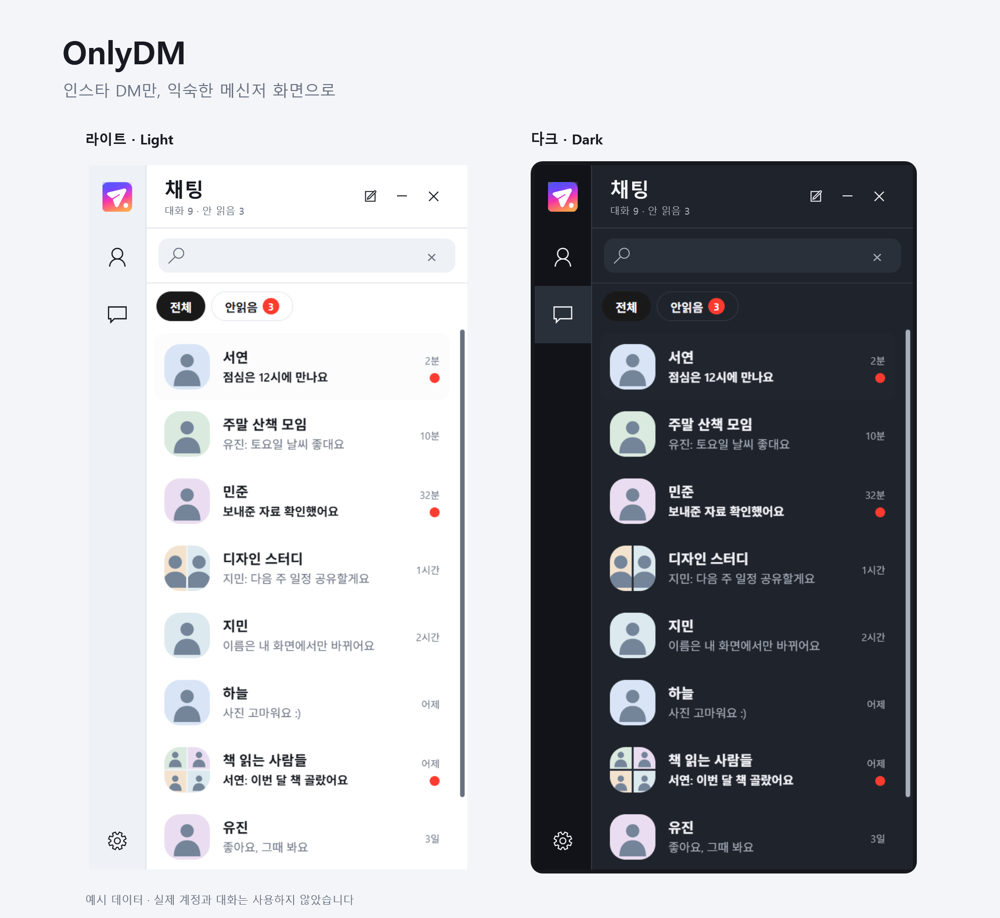
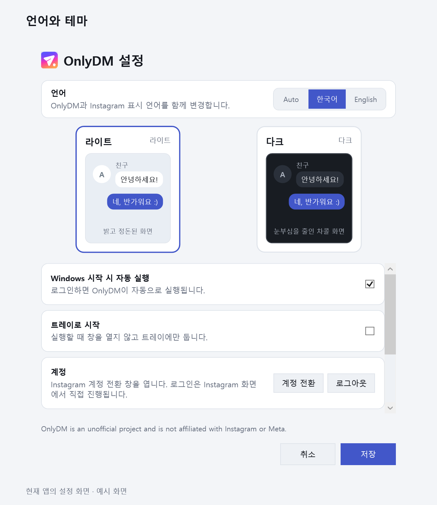

# OnlyDM

<p align="center">
  <strong>한국어</strong> · <a href="README.en.md">English</a>
</p>

**인스타 DM만 띄워두는 데스크톱 메신저.**

회사에서 카카오톡 창은 그냥 띄워둡니다. 그런데 인스타그램은 그러기가 좀 그렇더라고요. 피드에 릴스에 스토리까지 한 화면에 다 나오니까요. 그렇다고 답장하겠다고 폰을 계속 손에 들고 있을 수도 없고요.

그래서 깎고 깎아서 **DM만 남겼습니다.** 피드도, 릴스도, 탐색 탭도 안 뜹니다. 대화 목록과 채팅창만 있는 평범한 메신저 창처럼 보입니다.

저랑 같은 고민 하셨던 분들은 편하게 가져다 쓰세요.



<sub>윈도우판 라이트·다크 예시입니다. 현재 앱 UI에 가상의 이름·메시지·프로필 이미지를 넣었습니다. 실제 계정이나 대화는 포함하지 않았습니다.</sub>

## 어떻게 동작하나요

로그인과 메시지는 전부 **인스타그램 웹**에서 일어납니다. 윈도우는 Microsoft Edge WebView2를, Ubuntu 시험판은 Chromium을 사용해 브라우저로 접속할 때와 같은 페이지를 띄웁니다.

OnlyDM은 그 위에 자기 화면을 그립니다. 인스타그램이 이미 그려놓은 대화 목록을 읽어서 메신저 UI로 다시 보여주는 방식이라, 비공식 API를 뚫거나 서버를 따로 두지 않습니다. 별도 서버가 아예 없습니다.

## 쓰는 느낌

윈도우판은 써오던 메신저와 최대한 비슷하게 맞췄습니다.

**대화**

- 최신 대화가 위로 올라오고, 안 읽은 방에는 빨간 배지가 붙습니다
- 이름·아이디·직접 지은 이름 중 아무거나로 검색됩니다
- 더블클릭이나 <kbd>Enter</kbd>로 채팅방 열기, <kbd>↑</kbd> <kbd>↓</kbd>로 이동, <kbd>Esc</kbd>로 닫기
- 채팅창을 닫았다 다시 열면 쓰던 메시지가 남아 있습니다. 다만 앱을 종료하거나 오래된 창이 메모리에서 정리되면 초안은 유지되지 않습니다
- 한 번 열어본 방은 주소를 기억해서 다음부터 훨씬 빨리 열립니다
- 채팅에서 웹 링크를 누르면 대화창은 그대로 두고 기본 브라우저에서 엽니다

**사람**

- 친구 목록은 팔로잉에서 가져옵니다. 한 번 불러오면 저장해두고, 필요할 때 새로고침만 누르면 됩니다
- 프로필을 누르면 1:1 채팅 · 음성 통화 · 영상 통화
- 새 채팅은 사람을 고르기만 하면 됩니다. 한 명이면 개인방, 여러 명이면 단체방, 이미 있는 방이면 그 방으로 갑니다

**이름 바꾸기**

- 채팅창 제목이나 프로필 카드에서 **이름 위에 마우스를 올리고 그냥 고치면** 됩니다
- 아이디에 붙는 이름이라, 채팅방에서 바꾸면 친구 목록도 같이 바뀝니다. 반대도 마찬가지고요
- 단체방은 방 이름을 따로 붙일 수 있습니다
- **이건 제 컴퓨터에서만 바뀝니다.** 인스타그램에도, 상대방 화면에도 전혀 반영되지 않아요. 마음 편하게 바꾸세요
- 비워두면 원래 이름으로 돌아갑니다

**그 외**

- 라이트·다크 테마를 지원합니다. 왼쪽 아래 **톱니바퀴 아이콘(설정)**에서 테마를 고르고 저장하면 열려 있는 화면에도 바로 반영됩니다
- 한국어·영어 UI를 지원합니다. 설정의 **화면 및 언어**에서 `Auto` · `한국어` · `English`를 고르고 저장하면 됩니다. `Auto`는 Windows 표시 언어가 한국어면 한국어, 그 외에는 영어를 사용하며 Instagram 표시 언어도 함께 맞춥니다
- 설정에서 로그아웃하거나 Windows 자동 시작과 트레이로 시작을 켜고 끌 수 있습니다
- X를 누르면 트레이로 내려갑니다. 트레이 아이콘을 우클릭하면 알림과 열일 모드의 켬·끔 상태를 보고, 테마와 자동 시작도 바꿀 수 있어요
- 페이지가 죽으면 알아서 다시 불러오고, 더 크게 문제가 생기면 스스로 재시작합니다



<sub>윈도우판에서 왼쪽 아래 톱니바퀴 아이콘(설정)을 누르면 언어와 테마를 바꿀 수 있습니다.</sub>

## 계정 전환과 DM 알림

윈도우에서는 **설정 → 계정 전환**, Ubuntu에서는 대화 목록 위의 **계정 전환** 메뉴를 사용합니다. **계정 추가**를 고르면 별도 브라우저 프로필에서 인스타그램 공식 로그인 화면이 열립니다. 새 프로필마다 처음 한 번 직접 로그인하면, 로그인 상태가 유지되는 동안 메뉴에서 바로 전환할 수 있습니다. 인스타그램에 연결된 프로필은 **Instagram 프로필 선택…**에서 공식 계정 선택 화면을 열어 고를 수 있습니다. 휴대폰에서 로그인해 둔 상태가 그대로 넘어오지는 않습니다.

OnlyDM을 실행 중이고 각 계정의 브라우저 세션에 로그인되어 있으면, 현재 보고 있지 않은 계정의 새 DM도 데스크톱 알림으로 뜹니다. 알림에 어느 계정으로 왔는지 표시되고, 누르면 그 계정의 대화 목록으로 전환됩니다. 윈도우에서 현재 계정으로 온 알림은 해당 채팅방을 열 수 있습니다. 백그라운드에서는 계정별 받은편지함만 확인하며 채팅방 탭은 열지 않습니다. Ubuntu에서는 데스크톱 알림 서비스가 실행 중이어야 합니다.

Windows와 Ubuntu의 **설정 → 열일 모드**를 켜면 모든 계정의 새 DM 알림에서 이름과 메시지 내용을 가립니다. 제목은 ‘시스템’, 본문은 ‘점검이 필요합니다’ 같은 일반 안내 문구로 바뀝니다. 알림을 보낸 앱은 OnlyDM으로 표시됩니다. Windows에서는 트레이 우클릭 메뉴에서도 켜고 끌 수 있고, 평소에는 메시지 미리보기 표시를 따로 고를 수 있습니다. Ubuntu판은 열일 모드를 꺼도 메시지 본문을 알림에 표시하지 않습니다.

일시적인 오류로 백그라운드 받은편지함을 열지 못하면, 앱이 실행 중인 동안 횟수 제한 없이 다시 시도합니다. 윈도우는 보통 15~30초 기다립니다. Ubuntu는 5초 → 30초 → 60초 → 2분으로 간격을 늘리고, 그 뒤로는 2분마다 시도합니다. 인스타그램이 다시 인증을 요구하면 해당 계정의 확인을 멈춥니다. 앱을 종료하면 모든 확인이 끝납니다.

## 이건 걱정 안 하셔도 됩니다

**자동 로그인은 이 컴퓨터에만 저장됩니다.** WebView2와 Chromium이 브라우저처럼 세션을 들고 있는 것이고, OnlyDM 코드는 비밀번호도 쿠키도 토큰도 따로 꺼내 저장하지 않습니다. 로그인과 메시지 통신은 인스타그램 웹이 담당하며, OnlyDM 자체 서버는 없습니다.

윈도우에서 바꾼 이름, 대화방 주소, 친구 목록 캐시는 전부 내 PC에만 저장되고, 윈도우 DPAPI로 이 계정에서만 열리게 잠급니다.

윈도우 저장 위치는 `%LOCALAPPDATA%\OnlyDM` 한 곳입니다.

| 위치 | 들어 있는 것 |
| --- | --- |
| `WebView2\` | 첫 계정의 인스타그램 로그인 세션 (WebView2가 관리) |
| `Accounts\<id>\` | 추가 계정의 로그인 세션과 로컬 데이터 |
| `settings.json` | 테마·언어·알림·자동 시작·트레이 시작 설정 |
| `threads.json` · `friends.json` · `aliases.json` | 대화방 주소, 친구 목록, 내가 지은 이름 (DPAPI 보호) |
| `error.log` | 문제 확인을 위한 오류 기록 |

로그인 세션과 로컬 데이터를 지우려면 OnlyDM을 종료한 뒤 이 폴더를 삭제하면 됩니다. 앱까지 지우려면 `odm uninstall`을 실행하세요. npm으로 설치한 CLI도 없애려면 `npm uninstall -g @thisnorm/onlydm`을 추가로 실행하면 됩니다.

자세한 내용은 [PRIVACY.md](PRIVACY.md)에 적어뒀습니다.

## 설치

설치 안내는 [GitHub 릴리스 v1.1.3](https://github.com/thisNorm/OnlyDM/releases/tag/v1.1.3) 기준입니다.

### 윈도우에서 PowerShell로 설치

```powershell
$releaseTag = 'v1.1.3'
$installer = Join-Path $env:TEMP 'OnlyDM-install.ps1'
Invoke-WebRequest -Uri "https://github.com/thisNorm/OnlyDM/releases/download/$releaseTag/install.ps1" -OutFile $installer
& powershell.exe -NoProfile -ExecutionPolicy Bypass -File $installer -ReleaseTag $releaseTag
Remove-Item -LiteralPath $installer -Force
```

x64인지 ARM64인지 알아서 고르고, 받은 파일을 SHA-256으로 확인한 뒤 `%LOCALAPPDATA%\Programs\OnlyDM`에 설치합니다. 관리자 권한은 필요 없습니다. 설치나 업데이트 전에는 트레이 메뉴의 종료나 `odm stop`으로 OnlyDM을 종료해 주세요.

**필요한 것**: 윈도우 10/11(x64 또는 ARM64), 그리고 Edge WebView2 런타임. WebView2가 없으면 설치해도 되는지 먼저 물어본 다음 마이크로소프트 공식 설치 프로그램을 받아서 실행합니다. .NET은 따로 안 깔아도 됩니다(배포본에 포함).

### npm CLI로 실행하기 (윈도우, 선택 사항)

Node.js 18 이상이 있다면 npm CLI를 선택해서 사용할 수 있습니다.

```powershell
npm install -g @thisnorm/onlydm
odm start
```

앱이 이미 설치되어 있으면 `odm start`가 기존 앱을 실행합니다. 앱이 없으면 npm CLI와 같은 버전의 앱을 받아 설치합니다.

### 윈도우에서 실행과 관리

| 명령어 | 설명 |
| --- | --- |
| `odm start` · `odm stop` · `odm restart` | 실행 · 종료 · 재시작 |
| `odm status` | 설치·실행·WebView2·자동 시작 상태 확인 |
| `odm on` · `odm off` | 윈도우 시작 시 자동 실행 켜기/끄기 |
| `odm update` | 앱 업데이트 (설치 방식에 따른 차이는 아래 참고) |
| `odm uninstall` | 앱과 로컬 데이터 삭제 |

처음 실행하거나 로그인 세션이 만료되면 **인스타그램 공식 로그인 화면**이 먼저 열립니다. 여기서 직접 로그인하면 OnlyDM 대화 목록으로 넘어갑니다. 로그인 후에는 피드·릴스·탐색 화면을 표시하지 않습니다.

### Ubuntu 24.04 x64 시험판

릴리스용 설치 파일 이름은 `OnlyDM-linux-x64.deb`입니다. [Ubuntu 설치 안내](linux/README.md)를 참고하세요. 시험판은 대화 목록과 검색, 기존 대화에서 메시지 읽기와 보내기, 계정 전환, DM 알림과 열일 모드를 지원합니다. 친구 목록, 새 채팅, 음성·영상 통화, 트레이는 포함되지 않습니다.

## 윈도우 업데이트

v1.1.3으로 업데이트하려면 OnlyDM을 트레이에서 **종료**한 뒤 위의 PowerShell 설치 명령을 다시 실행하면 됩니다. 설치 스크립트는 앱 파일을 교체하며 기존 로그인 세션과 설정은 유지합니다.

최신 GitHub 릴리스로 업데이트하려면 설치본에 포함된 CLI를 전체 경로로 실행하세요.

```powershell
& "$env:LOCALAPPDATA\Programs\OnlyDM\cli\odm.cmd" update
```

npm으로 전역 설치한 `odm update`는 npm CLI 버전에 맞는 GitHub 릴리스를 설치합니다. 예를 들어 npm CLI 0.2.9는 앱 v0.2.9를 설치하므로, 이미 설치한 앱보다 낮은 버전으로 돌아갈 수 있습니다. `odm --version`은 npm CLI 버전을 보여줍니다.

## 잘 안 될 때

**로그인 화면이 안 나오고 계속 목록을 불러온다고 할 때** — 새 로그인 세션에서 화면이 숨겨지는 문제는 v0.2.9에서 수정했습니다. 먼저 앱을 업데이트해 주세요. 계속되면 [이슈](https://github.com/thisNorm/OnlyDM/issues)에 사용 중인 버전과 오류 화면을 남겨주세요. 대화 내용이나 상대방 정보는 가려주세요.

**인스타그램이 추가 인증을 요구할 때** — OnlyDM에 인스타그램 공식 인증 화면이 표시되면, 앱 안에서 안내에 따라 인증을 마쳐 주세요.

**처음 켰을 때 목록이 비어 있을 때** — 인스타그램은 대화 목록을 조금씩만 그려주기 때문에, 전체를 모으려고 한 번 훑습니다. 대화가 많으면 잠깐 걸립니다.

## 윈도우판 직접 빌드하기

개발할 때는 .NET 8 SDK가 필요합니다.

```powershell
# 소스에서 실행
dotnet run --project .\src\OnlyDM\OnlyDM.csproj

# 정책 테스트 + Release 빌드 + 배포 검사 + UI 계약 검사
powershell -ExecutionPolicy Bypass -File .\scripts\verify.ps1

# 배포용 zip + SHA-256 만들기 (artifacts 폴더)
powershell -ExecutionPolicy Bypass -File .\scripts\package.ps1
powershell -ExecutionPolicy Bypass -File .\scripts\package.ps1 -RuntimeIdentifier win-arm64
```

`v*` 태그를 푸시하면 [릴리스 워크플로](.github/workflows/release.yml)가 검증하고, x64/ARM64 자체 포함 빌드를 만들어 체크섬과 함께 GitHub Release로 올립니다.

<details>
<summary>손으로 확인해보는 항목들</summary>

1. 새 로그인 세션에서는 로그인 화면이 보이고, 로그인 후에는 대화 목록만 보이는지
2. 로그인 후 껐다 켜면 세션이 유지되는지
3. 검색이 걸리고 지우면 원래대로 돌아오는지
4. 채팅창 두 개를 열고, 앱을 실행한 상태에서 쓰던 메시지가 닫았다 열어도 남아 있는지
5. 채팅창에서 이름을 바꾸면 친구 목록과 대화 목록도 따라오는지
6. 다른 계정에 온 DM 알림을 누르면 그 DM을 받은 계정의 대화 목록으로 전환되는지
7. 테마와 언어를 바꾸고 저장한 뒤 재실행해도 유지되는지
8. X로 트레이에 내려갔다가 트레이 메뉴로 다시 열리는지
9. `odm status` · `odm on` · `odm off` · `odm restart`가 상태를 맞게 알려주는지
10. 재설치가 되고, 삭제하면 `%LOCALAPPDATA%\OnlyDM`이 없어지는지

</details>

## 라이선스

MIT입니다. [LICENSE](LICENSE)를 보세요. 마음대로 가져다 쓰고 고치셔도 됩니다.

OnlyDM은 개인이 만든 비공식 프로그램이며 Instagram·Meta와 제휴하거나 공식 지원을 받는 프로젝트가 아닙니다.
